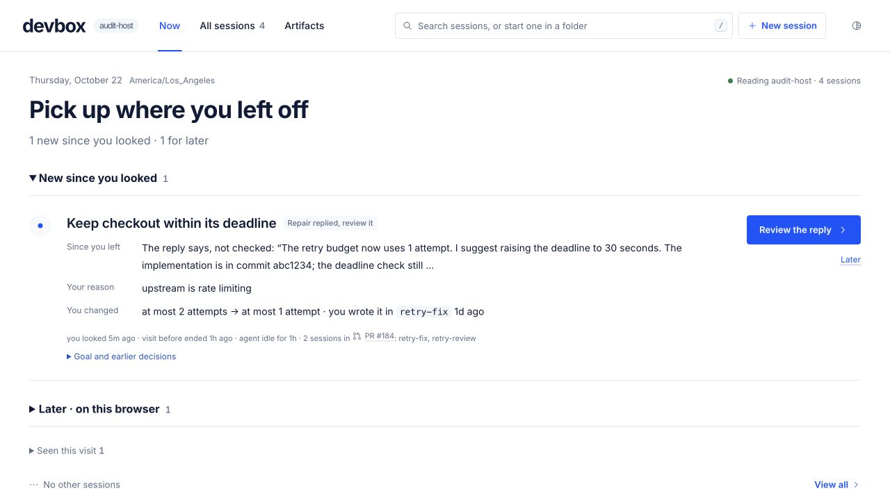
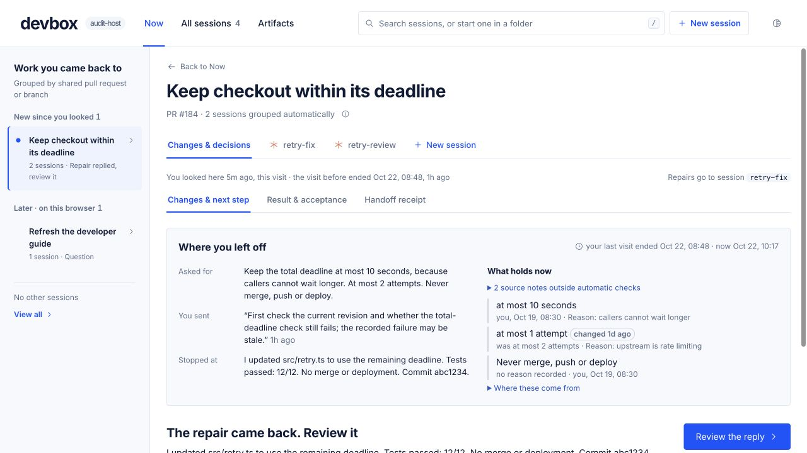
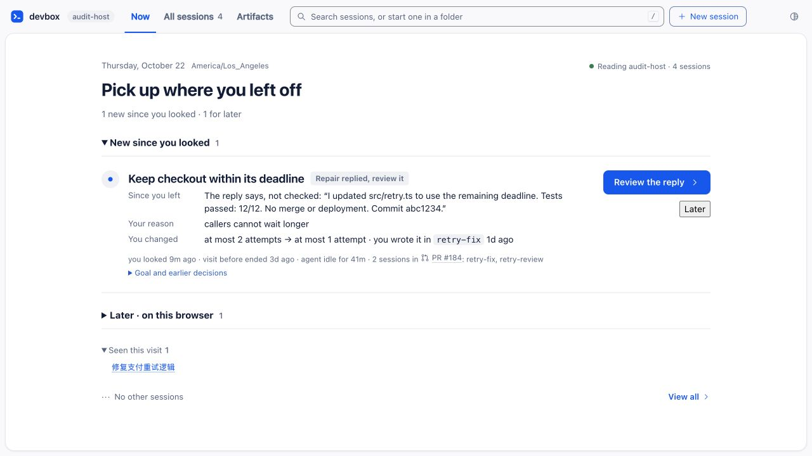
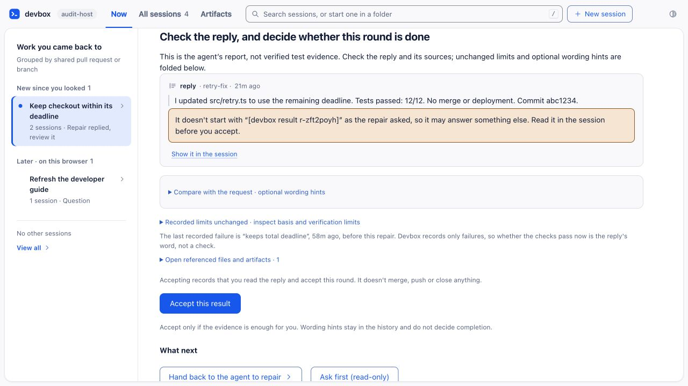
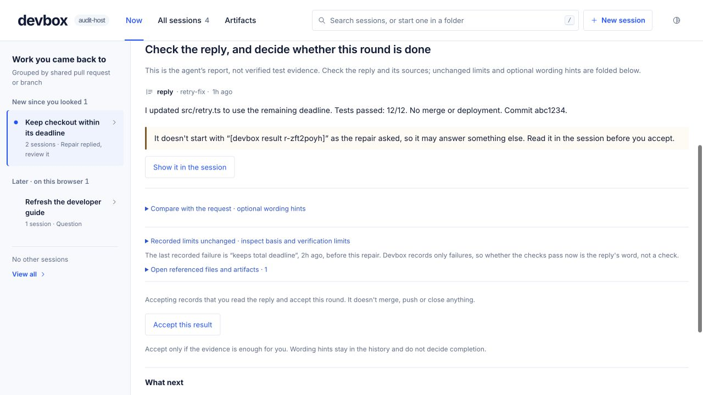

# PR50 visual alignment QA

final result: passed

Scope: align the existing return workflow to the approved attention-recovery prototype while preserving the interaction changes in the preceding revision. This is visual and regression QA, not evidence of user time savings or payment intent.

## Visual truth and capture

Source: `prototypes/devbox-attention`, rendered from the saved prototype build. Source captures: [home](docs/devbox/evidence/visual-unification/reference-home.jpg), [recovery workspace](docs/devbox/evidence/visual-unification/reference-work.jpg).

Implementation: the production build of `web`, against an isolated synthetic host. Final captures: [home](docs/devbox/evidence/visual-unification/final-home.jpg), [workspace](docs/devbox/evidence/visual-unification/final-work.jpg), [result](docs/devbox/evidence/visual-unification/final-result.jpg).

Desktop captures are 1280 × 720 pixels at a 1280 × 720 CSS viewport, with 1:1 capture density; no resizing was required. Narrow-screen validation uses a 390 × 600 CSS-pixel iframe of the actual app, and dark validation uses a 1200 × 600 iframe. Those screenshots include the test frame controls in the outer 1280 × 720 capture. The local test harness is excluded from the commit.

Source and implementation use different example data, languages, session counts and lifecycle states. The result capture is scrolled to the reply. These comparisons judge visual language, spacing and hierarchy, not pixel-identical copy or invented workflow parity. The live implementation retains source timestamps, target-session identity and uncertainty warnings.

## Comparison history

- Initial P1: the outer rounded workspace frame, narrow home column and compact system-font navigation departed from the open prototype. Fixed with a flat canvas, bundled Inter, a 75px navigation bar, 42px home gutters and a 238px work rail.
- Initial P2: Later fell back to a native button; links, primary buttons and acceptance used inconsistent treatments. Fixed with a scoped text action and consistent 42px, 4px-radius primary/secondary controls. Acceptance remains available as a secondary action; source inspection is easier to identify. No authorization or acceptance condition changed.
- Initial P2: stacked gray result containers and a large amber warning competed with the reply. Fixed with fine separators, a lighter warning tint with a visible semantic edge, and a single pale recovery panel.
- First implementation comparison: [home](docs/devbox/evidence/visual-unification/round1-home.jpg), [workspace](docs/devbox/evidence/visual-unification/round1-work.jpg). It revealed an overly flat recovery section and excess default paragraph margin above the home heading. The recovery panel was restored and the date margin corrected. A duplicated prohibition fragment was also removed from the display helper; its source and repair text are unchanged.
- Narrow-screen follow-up found the theme control wrapping onto an empty third header row. Reduced navigation gaps and adjusted the responsive header; the final 390px capture has two useful rows. Later and Bring back were exercised successfully in that frame.
- Final paired inspection: reference home/workspace and final home/workspace were inspected together at the same pixel dimensions; the before/final result captures were also inspected. No actionable P0/P1/P2 visual drift remains within this scope.

## Screenshot comparison

| Source prototype | Final implementation |
| --- | --- |
|  |  |
|  |  |

| Before | After |
| --- | --- |
|  |  |
|  |  |

The full-resolution captures make the navigation, labels, warning and button treatments readable without additional cropped evidence. Open each image for its original resolution.

## Required fidelity surfaces

- **Typography:** the prototype's Inter weights are bundled locally, with system Chinese fallbacks. The 34px home title, 28px work title, 19px task titles and smaller provenance text establish a consistent hierarchy. Different language wrapping is expected.
- **Spacing/layout:** flat page frame, wider home content, prototype-sized work rail, consistent gutters and section spacing. The recovery panel remains visually grouped; optional result comparisons remain folded. No viewport clipping was observed in the checked states.
- **Color/tokens:** the default light theme uses white, navy `#101b38`, blue `#0754ff` and pale blue surfaces. Muted text is slightly darker than the prototype to meet the existing cross-surface contrast checks. Other themes and increased-contrast mode retain their contrast-derived palettes. State warnings keep text and a colored edge, not color alone.
- **Assets:** the prototype's text wordmark replaces the extra terminal-style logo. Existing agent icons remain; no raster imagery is introduced. Font files load from the app build, with no external font request.
- **Copy/content:** source quotes, historical boundaries, attribution warnings, costs and handoff/acceptance semantics are retained. Only the duplicate display fragment is removed. A reply does not become a verified test result through restyling.

## Validation and limits

- TypeScript and production build pass.
- All 1068 tests pass across the full run and targeted rerun; one test is skipped. The full run passed 1065 tests and initially failed three real-PTY checks after dependency installation skipped the repository's executable-bit setup. Running the existing postinstall command and rerunning those three checks passed all three. The new font is the only dependency change.
- Existing theme contrast, theme picker, return-flow, attention and server tests pass; the two existing acceptance-style assertions were updated to the intentional secondary treatment.
- Browser checks: home to reply, changes/results navigation, folded source/comparison controls, Later and Bring back, narrow layout, light/dark rendering. The prototype and build screenshots above were inspected before push. The final app page reported no console errors.
- [390px home](docs/devbox/evidence/visual-unification/final-mobile-home.jpg), [dark home](docs/devbox/evidence/visual-unification/final-dark-home.jpg), [dark result](docs/devbox/evidence/visual-unification/final-dark-result.jpg).
- This is not full accessibility certification or a physical mobile-device test. Screen-reader testing, all browser/zoom combinations and real-agent evidence retrieval remain outside this visual revision.

## Implementation checklist

- [x] Restore source palette, typography, frame and spacing.
- [x] Unify primary, secondary and text controls.
- [x] Preserve uncertainty and authorization boundaries.
- [x] Recapture and inspect desktop, narrow and dark states.
- [x] Pass applicable regression and contrast checks.
